# Expressive Profile

Generator of GitHub profile READMEs in the Material 3 Expressive style. The profile is set up on the site and installed into the profile repository. A GitHub Action then refreshes the stats every hour.

Fork of Expressive Profile with aim to feel more custom/personalized

<p align="center">
  <a href="https://metawka.github.io/expressive-profile/"><b>Open the generator</b></a>
  &nbsp;·&nbsp;
  <a href="https://github.com/metawka">Live example</a>
  &nbsp;·&nbsp;
  <a href="https://github.com/marketplace/actions/expressive-profile">GitHub Marketplace</a>
</p>

<p align="center"><a href="https://github.com/metawka/expressive-profile/stargazers"><picture><source media="(prefers-color-scheme: dark)" srcset="docs/star-badge-dark.svg"></picture></a></p>

<div align="center">

<a href="https://github.com/djleamen"><picture><source media="(prefers-color-scheme: dark)" srcset="docs/djleamen-profile/assets/hero-dark.svg"></picture></a>

<picture><source media="(prefers-color-scheme: dark)" srcset="docs/djleamen-profile/assets/stats-dark.svg"></picture>

<picture><source media="(prefers-color-scheme: dark)" srcset="docs/djleamen-profile/assets/streak-dark.svg"></picture>

<sub>Live cards from <a href="https://github.com/djleamen">github.com/djleamen</a>, refreshed hourly by the Action. The look follows the GitHub light or dark theme.</sub>

</div>

## Features

- Blocks: header, socials, about, tech stack, project cards, activity, streak, divider, link buttons.
- Live preview with editing by click, drag to reorder, hiding blocks.
- Material 3 color palette built from one color, a custom color or an image. Five palette styles, light and dark themes.
- Optional **Chrome / Afterhours** skin: black and silver, ice-blue accents, cut-corner panels and original engraved lance ornaments.
- Eight Material 3 shapes for the avatar, project cards and social icons.
- Typing animation for the subtitle and animations in every card. Animations can be turned off.
- Icon search across Material Symbols and Simple Icons.
- Templates, a shareable link to a setup and a "make one like this" page for any profile built with the generator.
- English interface.
- Upload your own header image instead of using your GitHub photo.

## Screenshots

<table>
  <tr>
    <td colspan="2"></td>
  </tr>
  <tr>
    <td colspan="2" align="center">Editor: live preview, editing by click, drag to reorder</td>
  </tr>
  <tr>
    <td colspan="2"></td>
  </tr>
  <tr>
    <td colspan="2" align="center">Templates, main color and palette styles</td>
  </tr>
  <tr>
    <td width="50%"></td>
    <td width="50%"></td>
  </tr>
  <tr>
    <td align="center">Activity, streak and link buttons</td>
    <td align="center">Install to GitHub or download an archive</td>
  </tr>
  <tr>
    <td colspan="2"></td>
  </tr>
  <tr>
    <td colspan="2" align="center">The "Made with Expressive Profile" link under a profile opens a page with its setup</td>
  </tr>
</table>

## Usage

1. Open the [generator](https://metawka.github.io/expressive-profile/) and enter a GitHub username.
2. Set up the blocks and press **Download**.
3. **Install to GitHub** signs in with a GitHub code, creates the profile repository and uploads the files.

https://github.com/user-attachments/assets/ad14524b-1529-4637-8612-7cb41c5eee35

Manual setup: **Download archive** gives a ZIP for a public repository named exactly like the username. All files from it are uploaded to that repository, including the `.github` and `.profile` folders.

Signing in uses the GitHub device flow with the `public_repo` and `workflow` scopes. The token stays in the browser tab and is used only for this upload. The sign-in proxy is open source, see [`proxy/`](proxy). If the repository already has a README, the generator asks before replacing it.

The first workflow run replaces the preview data with exact stats and pinned repositories. Then the profile updates every hour and commits only when the data changes, plus once a day for the calendar.

To change the profile later, edit `profile.json` in the repository or set it up again on the site and upload the new `profile.json`.

### Custom header image

Open **Header → Header image → Upload image** to choose a PNG, JPEG or WebP
(up to 10 MB). The image is center-cropped to a square, resized to 320 × 320,
and stored as an embedded PNG in `hero.image` in `profile.json` (up to 256 KB
after conversion). It works in both skins, stays in shared setups and exports,
and is not replaced by your GitHub photo during automatic refreshes.

Use **Use GitHub photo** to switch back. Uploaded images stay in your browser
until you share or export the profile; sharing includes the embedded image and
can produce a much longer URL. Remixing another person's style does not copy
their custom image.

Profiles with a custom image include `.profile/render.mjs` and a workflow that
runs it. Upload the entire archive, including `.profile`, rather than only the
SVGs or configuration, so automatic refreshes retain your image.

### Chrome / Afterhours

Select **Style → Visual skin → Chrome / Afterhours**. The skin changes the actual
exported SVGs as well as the editor, including projects, activity, socials and the
divider. It has coordinated dark and light palettes; the header theme button
previews both. Existing profiles remain Expressive unless you opt in.

The skin uses a fixed palette and angular frames. Expressive colors and shape
choices are preserved when switching back. Text, links, block order, icon choices
and animation settings are shared between skins. The configuration field is
`"skin": "chrome"`; omit it or use `"expressive"` for the original design.

Typography is self-hosted: **Barlow Condensed** for display headings, **IBM Plex
Sans** for body text and **IBM Plex Mono** for technical labels. Fonts are embedded
in the exported SVGs. Font metrics are generated
from the bundled fonts so the preview and Action use the same text sizing. Each
text-bearing Chrome SVG carries the font licenses in its metadata. The lance
ornaments and etched pattern are original SVG geometry, not borrowed brand artwork.

Chrome downloads and installations include `.profile/render.mjs` and a workflow
that runs it with Node.js. This prevents the upstream Expressive-only Action from
reverting the skin on its next refresh. Upload the **entire archive**, including
`.profile`, and re-export to receive future renderer changes. The original
Expressive export without a custom image continues to use the upstream Action.

## Made with Expressive Profile

- [metawka](https://github.com/metawka)

Profiles built with the generator can be added to this list with a pull request.

## Action

The archive contains this workflow:

```yaml
name: Expressive Profile

on:
  schedule:
    - cron: "17 * * * *"
  workflow_dispatch:
  push:
    paths:
      - profile.json
      - .profile/icons.json

permissions:
  contents: write

jobs:
  update:
    runs-on: ubuntu-latest
    steps:
      - uses: actions/checkout@v4
      - uses: metawka/expressive-profile@v1
        with:
          token: ${{ secrets.PROFILE_TOKEN || github.token }}
```

| Input | Default | Description |
| --- | --- | --- |
| `token` | `github.token` | Token for the GitHub API |
| `commit-message` | `Updated profile` | Message of update commits |

With the default token the language chart counts public repositories only. Private repositories are counted with a personal access token saved as the `PROFILE_TOKEN` secret.

## Privacy

The generator site counts visits with [GoatCounter](https://www.goatcounter.com/) on `metawka.github.io` only. No cookies are used and no personal data is stored.

## Development

Requirements: Node.js 20 or newer.

```bash
npm install
npm run dev
```

`npm run build` builds the site into `dist` and the Action renderer into `action/render.mjs`.
`npm test` checks renderer compatibility, Chrome output, contrast, font fitting,
export failures and regeneration by the bundled Action renderer.

The `proxy` folder contains the sign-in proxy deployed on Vercel. It forwards two device flow requests to GitHub and stores nothing.

## License

The code is under the [MIT License](LICENSE).

- Google Sans Flex: SIL Open Font License, see `fonts/`.
- [Barlow Condensed](https://fonts.google.com/specimen/Barlow+Condensed),
  [IBM Plex Sans](https://fonts.google.com/specimen/IBM+Plex+Sans) and
  [IBM Plex Mono](https://fonts.google.com/specimen/IBM+Plex+Mono): SIL Open Font License 1.1,
  see [`OFL-Barlow.txt`](fonts/OFL-Barlow.txt) and [`OFL-IBMPlex.txt`](fonts/OFL-IBMPlex.txt).
  Vendored WOFF2 subsets come from the Google Fonts CSS2 API (Barlow bold,
  Plex Sans variable 400–700 in Latin, Plex Mono medium in Latin).
  Normal builds read the local files and do not contact Google Fonts.
- Material Symbols: Apache License 2.0.
- Simple Icons: CC0 1.0. Brand icons belong to their owners.
